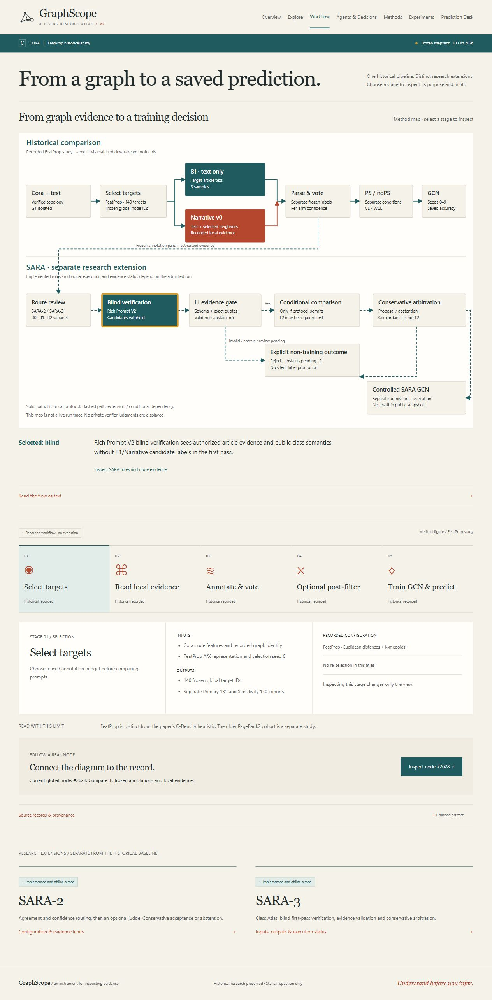
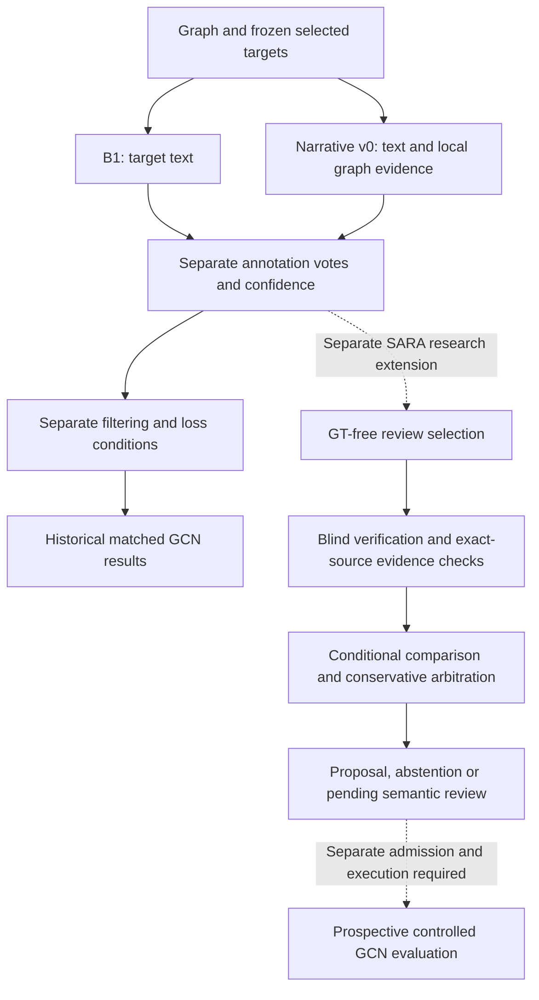

# GraphScope — Interactive Research Atlas

An interactive atlas for exploring how language models label text-attributed graph nodes, how local graph evidence changes annotation, and how saved pseudo-labels connect to downstream graph learning.

## Live Demo

**Deployment pending:** [parand1khalili.github.io/graphscope](https://parand1khalili.github.io/graphscope/).

## Preview

Captured from the locally verified production build. This is an evidence-inspection interface, not a live prediction API.

## Research Overview

The historical study compares **B1**, a target-text baseline, with **Narrative v0**, which adds recorded local graph context. Both use the same underlying language model. Frozen annotations and saved GCN outcomes remain separate from reconstructed SARA methods and proposed extensions.

The atlas connects a full admitted Cora topology to a smaller research evidence subset. Node identifiers, recorded neighborhoods, annotations and experiment conditions retain their original relationships.

## Research Workflow

The SARA lane describes method responsibilities and conditional boundaries; it is not evidence that a new experiment has completed.

## What You Can Explore

- **Overview:** the research question, context and historical comparison.
- **Explore:** graph navigation, node selection, search, filters and evidence inspection.
- **Workflow:** an interactive method diagram with inputs, outputs and limitations.
- **Agents & Decisions:** distinct routing, verification, validation and arbitration roles.
- **Methods:** published, historical, reconstructed and prospective methods.
- **Experiments:** separate cohorts, losses and filtering treatments, with paired seed-level outcomes.
- **Prediction Desk:** frozen parsed annotation samples and saved GCN class predictions where available.

## Technologies

React · TypeScript · Vite · Cytoscape · SVG research visualizations.

This repository contains a prebuilt static distribution. Development and data admission are maintained separately. There is no backend, API credential, paid inference service or model checkpoint requirement. Serve the files under `/graphscope/`; navigation uses hash routes so section links retain the static entry point.

## Evidence & Limitations

- Historical results are saved observations, not model runs performed by this website.
- B1 is a local paper-inspired baseline, not an exact reproduction of the published paper's B0. FeatProp is distinct from C-Density.
- Frozen parsed-sample replay is different from parsing original raw responses. Response hashes alone do not establish complete raw recovery.
- Source-byte identity establishes provenance, not scientific correctness. Confidence is vote-derived and is not a calibrated probability.
- L1 quotation/schema checks and automated concordance do not establish independent semantic L2 validity.
- Reconstructed/offline-tested SARA methods and proposed extensions are labeled separately. No SARA-3 GCN improvement is established by this snapshot.
- Training-seed population SD is not uncertainty across independent LLM annotation runs. Cora was used for development; these records are not untouched confirmatory evidence.
- Missing judgments, titles, checkpoints and unavailable studies are shown explicitly rather than fabricated.

## Research Context & Contact

Research and atlas: **Parand Khalili**, LLM-GNN / SARA project.

Foundational reference: Chen et al., [*Label-Free Node Classification on Graphs with Large Language Models (LLMs)*](https://proceedings.iclr.cc/paper_files/paper/2024/hash/862819c227b16f9af64dd6ad6cfdf275-Abstract-Conference.html), ICLR 2024. The local graph-context and SARA extensions are separate from the published method.

[GitHub](https://github.com/Parand1khalili) · [Portfolio](https://parand1khalili.github.io/)

Research collaboration on language models, graph learning and evidence-aware annotation is welcome. Third-party software notices are included in [THIRD_PARTY_NOTICES.txt](THIRD_PARTY_NOTICES.txt); they do not grant rights to the research data or project-specific material.
